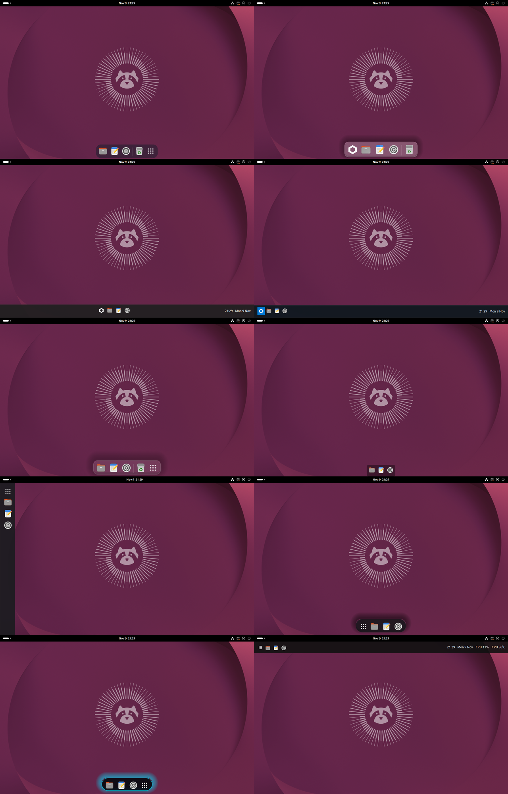
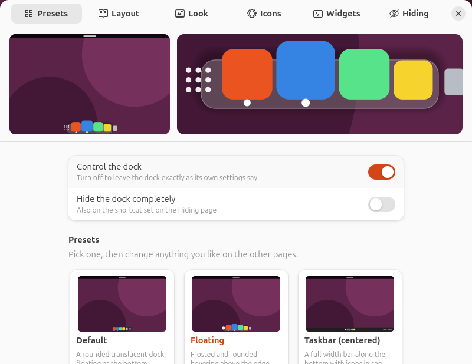
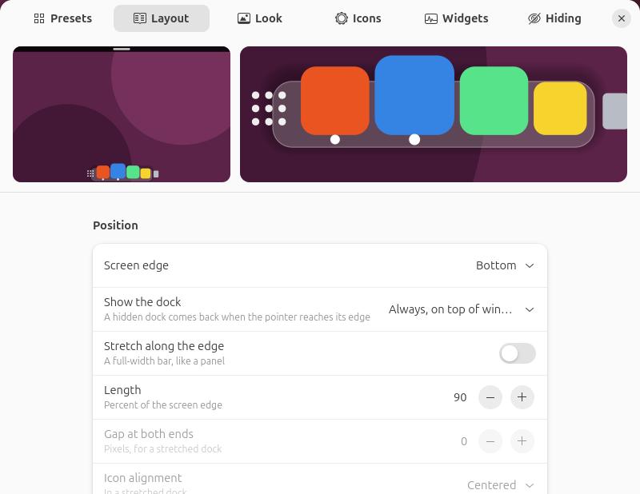
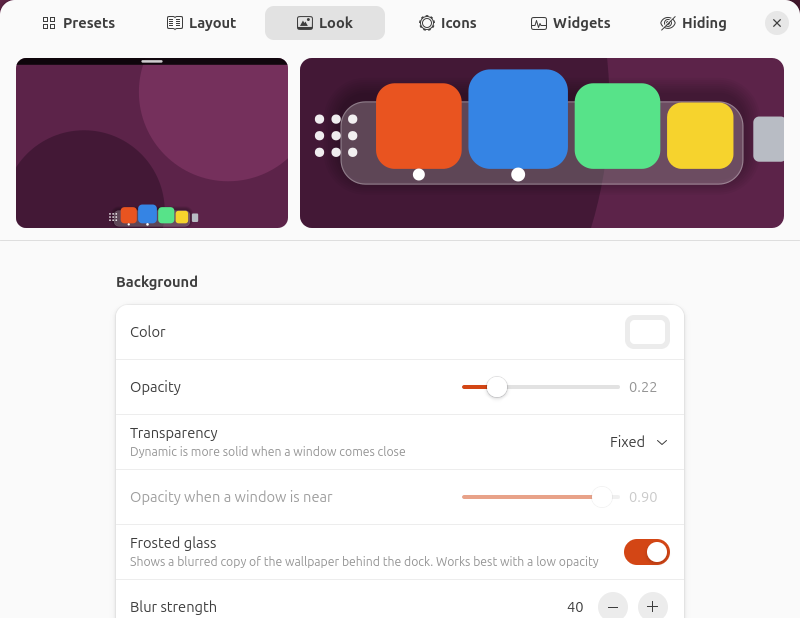
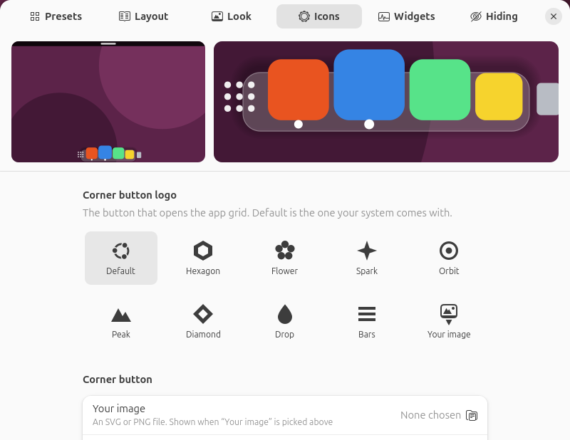
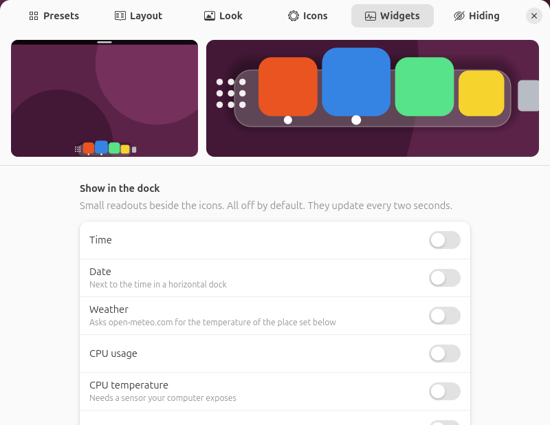
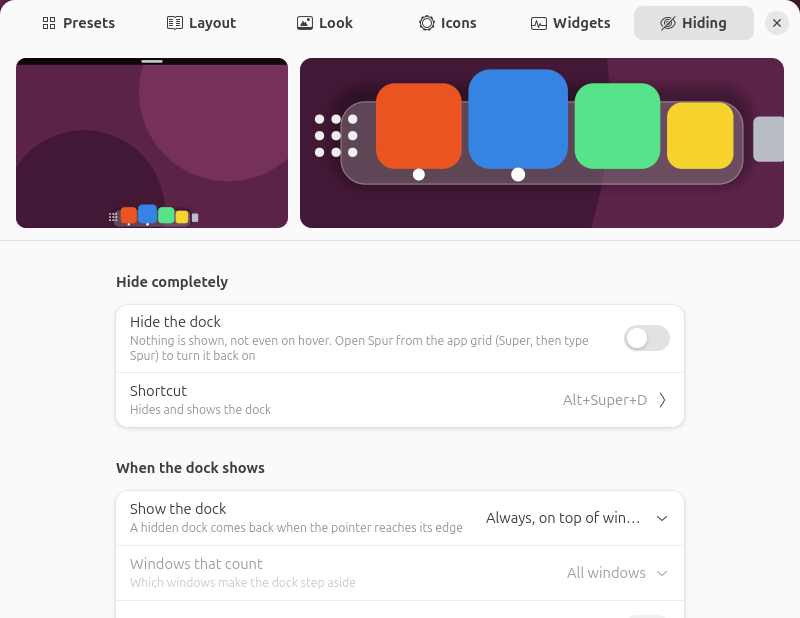
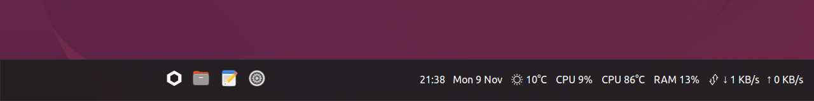
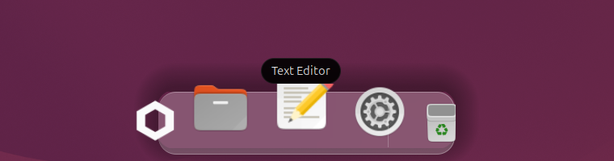

# Spur

Restyle the Ubuntu dock. Pick a preset, then change anything: where the dock sits, its size, colors, blur, the logo on its corner button, what it shows, and when it hides. You can also hide it completely.

Spur does not replace the dock. It drives the dock that Ubuntu already ships (`ubuntu-dock@ubuntu.com`) and adds styling, magnification, widgets and hiding on top, so pinned apps, window previews and drag and drop keep working as before.



The ten built-in presets, applied to a bare desktop.

| | |
|---|---|
|  |  |
|  |  |
|  |  |





The screenshots were taken in a test session on Ubuntu 26.04 with GNOME Shell 50.1.

## Requirements

- Ubuntu 26.04 with GNOME Shell 50
- The Ubuntu dock, which is installed and on by default
- A Wayland session, which is the Ubuntu default

Spur has only been tested on Ubuntu 26.04 with GNOME Shell 50.1 on Wayland.

## Install

### With the deb package (recommended)

Download `spur_1.0.0_all.deb` from the [latest release](https://github.com/webhookstudios/spur/releases/latest), then install it:

```bash
sudo apt install ./spur_1.0.0_all.deb
```

Log out and back in, then open **Spur** from the apps menu. The first time, that turns the extension on and opens its settings.

### As an extension zip, without root

```bash
wget https://github.com/webhookstudios/spur/releases/latest/download/spur@webhookstudios.github.io.shell-extension.zip
```

```bash
gnome-extensions install --force spur@webhookstudios.github.io.shell-extension.zip
```

Log out and back in, then:

```bash
gnome-extensions enable spur@webhookstudios.github.io
```

### From source

```bash
git clone https://github.com/webhookstudios/spur.git
```

```bash
./spur/install.sh
```

## Presets

| Preset | What it looks like |
|---|---|
| Default | A rounded translucent dock at the bottom |
| Floating | Frosted and rounded, hovering above the edge, icons grow under the pointer |
| Taskbar (centered) | A full-width bar with icons in the middle, a logo button and a clock |
| Taskbar (left) | The same bar with icons at the left after a colored logo button |
| Glass | Clear frosted glass with a thin bright edge |
| Minimal | Small and quiet, hidden until you need it |
| Vertical panel | A full-height panel on the left edge |
| Pill | A fully rounded capsule floating above the bottom edge |
| Neon pill | A dark capsule with a glowing edge |
| Top bar | A slim full-width bar under the top panel, with clock and CPU readouts |

Click a preset to apply it. You can save your own look as a preset, export any preset to a file, and import preset files from other people.

## Settings

Open **Spur** from the apps menu, or run:

```bash
gnome-extensions prefs spur@webhookstudios.github.io
```

The preview at the top of the window follows every change. The left side shows the whole screen, the right side a close-up of the dock.

| Page | What you can change |
|---|---|
| Presets | Apply, save, import and export presets, turn Spur off, restore the stock dock settings |
| Layout | Screen edge, when the dock shows, stretching, length, icon alignment, icon size, spacing, padding, floating gap, corner radius, one dock per monitor |
| Look | Background color and opacity, dynamic transparency, frosted glass, border, shadow, icon highlight |
| Icons | Corner button logo, position and color, running-app indicators, Trash, drives, pinned and running apps, window previews, click action, magnification |
| Widgets | Time, date, weather, CPU usage, CPU temperature, memory use and network speed inside the dock, with your choice of font, size and color |
| Hiding | Hide completely with a shortcut; show always, on top of windows, until a window touches it, or only at the edge; reveal and hide delays, animation time |

### Corner button logo

The button that opens the app grid can show your system's default icon, one of eight shapes that come with Spur (hexagon, flower, spark, orbit, peak, diamond, drop, bars), or any SVG or PNG image of your own. The shapes are original drawings made for this project.

### Widgets

Widgets are off until you turn them on. They sit inside the dock next to the icons and suit stretched docks best.

- Time, date, CPU usage, CPU temperature, memory use and network speed are read from your own computer.
- Weather asks [open-meteo.com](https://open-meteo.com) for the current temperature. That only happens while the weather widget is on, and only the coordinates of the place you chose are sent. Searching for a city sends the name you typed.

### Hiding the dock

**Hide the dock** on the Hiding page removes the dock until you turn it back on. The default shortcut is <kbd>Super</kbd>+<kbd>Alt</kbd>+<kbd>D</kbd>, and you can change it.

## Good to know

- Spur writes to the Ubuntu dock's own settings. Before you remove it, use **Give the dock back to Ubuntu** on the Presets page to put those back.
- Frosted glass shows a blurred copy of your wallpaper, so a window that sits under the dock is not blurred through it.
- Magnified icons grow past the ends of the dock.

## Remove

```bash
sudo apt remove spur
```

Or, if you installed the zip or from source:

```bash
gnome-extensions uninstall spur@webhookstudios.github.io
```

## Development

```bash
ln -s "$PWD/spur@webhookstudios.github.io" ~/.local/share/gnome-shell/extensions/
```

```bash
glib-compile-schemas spur@webhookstudios.github.io/schemas
```

A Wayland session cannot reload extension code, so each change needs a logout. To try changes without logging out, run the checks in a headless nested shell with a throwaway home folder:

```bash
test/headless.sh
```

Build the release files into `dist/` with `./pack.sh` (extension zip) and `./build-deb.sh` (deb package, needs only `dpkg-deb`).

| File | Purpose |
|---|---|
| `extension.js` | Applies the settings to the dock: stylesheet, blur, logo, magnification, widgets, hiding |
| `model.js` | Maps Spur's settings onto the Ubuntu dock's settings |
| `presets.js` | The built-in presets |
| `css.js` | Builds the dock stylesheet from the settings |
| `widgets.js` | Reads the clock, system and weather values |
| `preview.js` | Draws the preview used in the settings window |
| `prefs.js` | The settings window |

## License

GPL-2.0-or-later. See [LICENSE](LICENSE).
